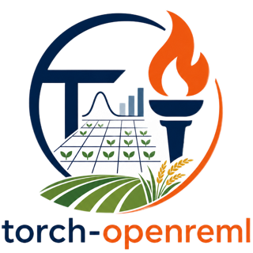

<p align="center">
  <a href="https://github.com/anu-aagi/torch-openreml/blob/main/docs/source/_static/hex-icon-readme.png">
    
  </a>
</p>

# torch-openreml

<p>
  
  
  
  =3.10">
  =2.0">
  
</p>

**torch-openreml** is a PyTorch-based library for AI-REML estimation of linear mixed models.

**Author & Maintainer:** Weihao (Patrick) Li — patrick.li@anu.edu.au

## Overview

torch-openreml fits linear mixed-effects models using the Average Information REML (AI-REML)
algorithm on a PyTorch backend. It supports flexible specification of covariance structures
through a modular system of matrices and operators, along with automatic or manual gradients and
optional parameter transformations for constrained estimation.

Unlike traditional mixed-model software, it does not provide a formula interface. Instead, users
define the fixed- and random-effects design matrices and covariance structures directly in code.
The library is focused purely on the computational and optimisation backend rather than model
specification syntax.

## Features

- **Torch-based backend** — built on PyTorch, running on CPU, GPU, and other available accelerators.
- **AI-REML estimation engine** — variance component estimation using average information restricted maximum likelihood, with a Newton-type scoring method, Armijo backtracking, and a gradient fallback.
- **Extensible covariance structure** — composable covariance structures and operators from built-in and user-defined components.
- **Hybrid differentiation support** — automatic differentiation and manually specified gradients.
- **Composable parameter transformations** — configurable, chainable transformation pipelines for flexible parameterisation.

## Installation

Install the released version from PyPI:

```bash
pip install torch-openreml
```

Or install the latest development version directly from GitHub:

```bash
pip install git+https://github.com/anu-aagi/torch-openreml.git
```

**Dependencies:** `torch>=2.0`, `pandas`, `tqdm` — Python 3.10 or later.

## Model

The library assumes the linear mixed-effects model

$$
\mathbf{y} = \mathbf{X}\boldsymbol{\beta} + \mathbf{Z}(\boldsymbol{\theta})\mathbf{b} + \boldsymbol{\varepsilon}
$$

with

$$
\mathbf{b} \sim \mathcal{N}(\mathbf{0}, \mathbf{G}(\boldsymbol{\theta})), \qquad
\boldsymbol{\varepsilon} \sim \mathcal{N}(\mathbf{0}, \mathbf{R}(\boldsymbol{\theta})),
$$

so that the marginal covariance of $\mathbf{y}$ is

$$
\mathbf{V}(\boldsymbol{\theta}) = \mathbf{Z}(\boldsymbol{\theta})\mathbf{G}(\boldsymbol{\theta})\mathbf{Z}(\boldsymbol{\theta})^\top + \mathbf{R}(\boldsymbol{\theta}).
$$

A design may be a fixed tensor, as in the example below, or a parameterised `Matrix` whose free
parameters are part of $\boldsymbol{\theta}$. Each random-effect term contributes its own design
block and covariance, and $\mathbf{Z}(\boldsymbol{\theta})\mathbf{G}(\boldsymbol{\theta})\mathbf{Z}(\boldsymbol{\theta})^\top$
is assembled from those blocks.

## Quick start

The example below fits `yield` from the bundled `john_alpha` dataset — a resolvable alpha lattice
trial — with an intercept, a fixed effect for `rep`, a random intercept for `gen`, and a random
`rep:block` interaction.

```python
import torch
from torch_openreml import MixedModelREML
from torch_openreml.covariance import (
    Augment, DummyMatrix, IdentityMatrix, KroneckerProduct, ScalarMatrix,
)
from torch_openreml.example_data import john_alpha

rep = john_alpha["rep"]
block = john_alpha["block"]
gen = john_alpha["gen"]
n = len(john_alpha)

y = torch.tensor(john_alpha["yield"].values)

# Fixed effects X = [1 | rep], with the first replicate absorbed by the intercept.
X = Augment(torch.ones(n, 1), DummyMatrix(rep, drop_first=True))()

# Each random-effect term is a (design, covariance) pair; the residual
# covariance is supplied with R=. G_rep = I is fixed for identifiability.
reml = MixedModelREML(
    genotype=(DummyMatrix(gen), ScalarMatrix(gen)),
    replicate_block=(DummyMatrix(rep, block), KroneckerProduct(
        G_rep=IdentityMatrix(rep),
        G_block=ScalarMatrix(block),
    )),
    R=ScalarMatrix(n),
)

print(reml)  # the marginal covariance assembled from those terms

# Optimise on the transformed scale (zeros mean unit variances here), then
# map the estimates back to variance components.
free_param_names, free_params = reml.optimize(y, X, torch.zeros(3), verbose=1)
print(free_param_names)
print(reml.build_params(free_params))

# Post-estimation: BLUE of the fixed effects, BLUPs of the random effects.
beta_hat = reml.blue()
b_hat = reml.blup()
gen_blup = reml.blup_per_term()["genotype"]
```

Fitting is performed on the transformed parameter scale. `build_params` maps the estimates back
to the original variance-component scale, with names given by the model's free-parameter names
(`['G/genotype/sigma^2', 'G/replicate_block/G_block/sigma^2', 'R/sigma^2']` in this example).

The response and design are stored on the model by `optimize`, so the post-estimation methods can
be called without repeating them. `blue` returns the fixed-effect estimates, `blup` returns one
prediction per random-effect level (the 24 genotypes followed by the 18 replicate-by-block
combinations), and `blup_per_term` splits the same predictions into a dict keyed by the term names
supplied to the constructor. `cov_blue`, `var_blue`, `cov_blup`, `var_blup` and their per-term
variants give the corresponding sampling covariances and variances.

## Documentation

Full documentation: **https://torch-openreml.patrickli.org**

- [Vignettes](https://torch-openreml.patrickli.org/vig) — worked examples, including the mixed-model and marginal REML workflows.
- [Technical Documentation](https://torch-openreml.patrickli.org/tech) — model formulation, REML and ML theory, score and AI matrix derivations.
- [API Reference](https://torch-openreml.patrickli.org/api) — `MixedModelREML`, `MarginalREML`, covariance matrices, operators, transforms, utilities, and example datasets.
- [For R Users](https://torch-openreml.patrickli.org/r_user)
- [Changelog](https://torch-openreml.patrickli.org/change_log)

## Citing

```bibtex
@software{torch_openreml,
  author = {Weihao Li},
  title  = {torch-openreml},
  year   = {2026},
  url    = {https://github.com/anu-aagi/torch-openreml/}
}
```

## Status

⚠️ **Experimental.** The library is under active development. Interfaces and implementations may
change without backward-compatibility guarantees, and it may be slightly inefficient.
